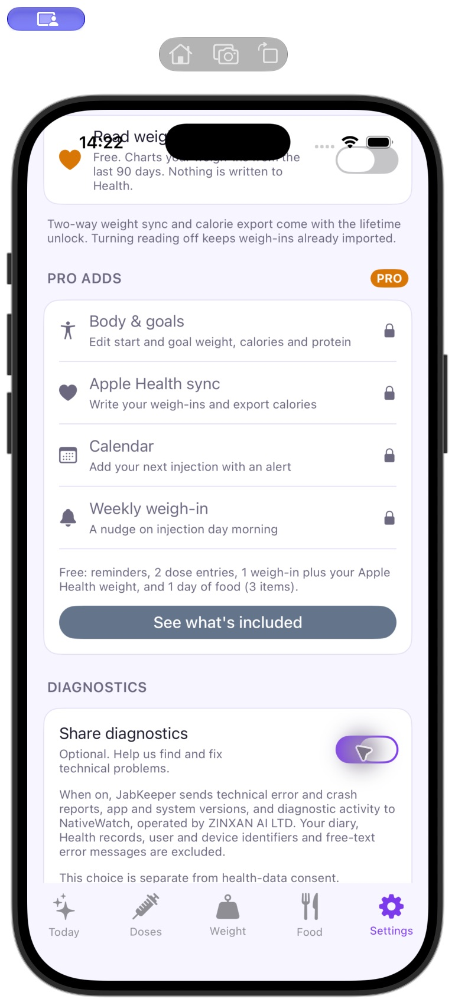

# JabKeeper Release Simulator acceptance

Verified on 2 November 2026 using the actual JabKeeper app, compiled with Xcode's
**Release** configuration, and mobile SDK runtime candidate
`c47acd82e7649556a186531d16424a9f1ae55410`. The app ran locally in **iOS Simulator**;
its receiver was NativeWatch production. This is not an App Store publication
or a physical-iPhone test. Version 0.2.1 remains a release target until its tag
and Composer package are published.

Tests used disposable app data. The native Settings toggle, normal Weight tab
and actual process crash/relaunch exercised the app, rather than submitting
handwritten events or inserting dashboard rows.

| Check | Actual result |
| --- | --- |
| Diagnostics off, then the normal Weight screen encounters a missing SQLite table | The original QueryException error screen remained visible. No SDK outbox or production issue-count growth was observed. |
| Diagnostics on, then the same normal Weight-screen failure | Production issue **49** grew from one to two occurrences. New event: `ab99bdbb-b1d4-43c2-afb4-1f7ecf522ea2`. |
| Successful SQLite query delayed by real database contention | The Queries page received the actual **11,203 ms** query activity. This was not a manually fabricated duration. |
| Release process receives SIGABRT, then the app is relaunched | The native crash was ingested as production issue **52**, event `eec447ce-a8b5-452d-8ad7-7c045a2c4044`. |
| The Release app cannot reach the receiver, then the normal Weight screen fails | One real QueryException remained in the app's durable outbox, event `6d0cb2e2-11ee-47d9-a3c1-faf87890114e`. The event was absent from production and issue **49** remained at two occurrences. |
| The table is restored and the app is relaunched with connectivity | The outbox drained from one to zero. The exact pending event arrived once and production issue **49** grew from two to three occurrences. |
| Consent is withdrawn, then the Release process receives SIGABRT | No pending native-recorder files remained. Relaunching and granting consent again did not send that crash; issue **52** stayed at one native-crash occurrence. |

The native UI adapter therefore has real Release Simulator evidence for the
missing component-error reporting path, consent gating, a query activity and
next-launch native crash ingestion, offline retention/retry and withdrawal of
native crash reporting. The PHP-only adapter does not change the Swift native
recorder.

The offline run used an unreachable HTTPS proxy scoped only to the Simulator
app process. It blocked that app's real network requests without changing the
Mac's network settings. This establishes delivery retry after an app-level
transport failure and relaunch. It is not a physical-device flight-mode test.
The original outbox read-back is in [offline-retention.json](offline-retention.json).

## Original screenshots

The files are copied unchanged from the actual Simulator captures. See
[SHA-256 checksums](screenshot-checksums.json). The Settings captures show their
current scroll position; they do not show the entire privacy disclosure at once.
Screenshots show UI state, while the collector read-back supplies the event and
count evidence above.

- [Diagnostics off](screenshots/release-consent-off.png)
- [Real Weight-screen error while sharing is off](screenshots/release-denied-error.png)
- [Diagnostics on](screenshots/release-consent-on.png)
- [Real Weight-screen error while sharing is on](screenshots/release-allowed-error.png)
- [Real Weight-screen error while the receiver is unreachable](screenshots/release-offline-error.png)

## Remaining limits

The exact dSYM upload was indexed, but the production symbolication job failed
during this run and remains under investigation. Native crash capture and
ingestion are verified; successful native function/file/line symbolication is
not established by this record.

Physical-device flight mode, MetricKit delivery and Android behavior were not
tested in this acceptance run. The library suite's controlled HTTP failures and
the actual Simulator app's unreachable-proxy test are separate checks; neither
is evidence of a physical flight-mode test. Do not describe these results as
covering every activity category or a complete platform release checklist.
